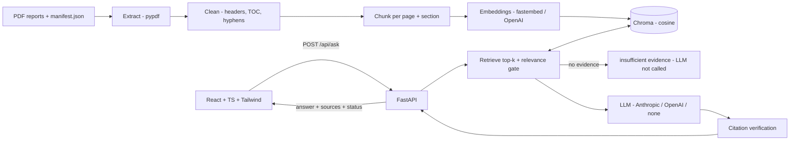
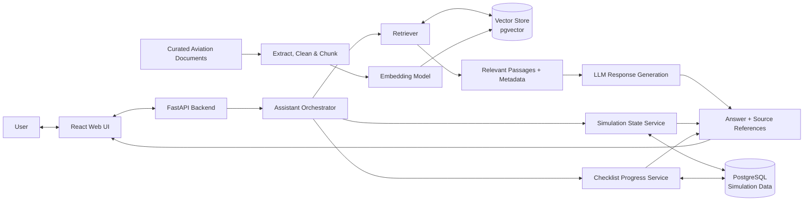
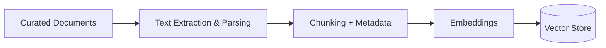

# AERIS Architecture

## Implemented today (Phase 1)
The diagrams below describe the target architecture. What exists now is the knowledge-retrieval
half, with Chroma standing in for pgvector (see TD-02):

Not built yet: simulation service, checklist service, orchestrator/agent tools, voice, AWS.

## High-level RAG + simulation architecture

## Request flow
1. The user submits a question through the web UI.
2. The backend classifies the request: knowledge question, simulation query, checklist query, or a combination.
3. The relevant service retrieves source passages and/or structured simulation records.
4. The response generator receives only the context needed for the request.
5. The API returns the answer, source references, and simulation timestamp where applicable.
6. The UI clearly distinguishes retrieved evidence, generated explanation, and simulated values.

## Document ingestion flow

## Component responsibilities
- **Web UI:** question entry, response display, citations, simulation status, checklist progress.
- **API:** validation, request/response schemas, error handling, API documentation.
- **Assistant orchestrator:** routes requests to permitted tools; no unrestricted autonomous actions.
- **Retriever:** semantic search over indexed document chunks.
- **LLM:** produces an answer from retrieved evidence and relevant simulation context.
- **Simulation service:** reads timestamped, explicitly simulated values from relational storage.
- **Checklist service:** reads and updates review status for simulation checklist items.
- **PostgreSQL + pgvector:** relational records and vector embeddings in the initial prototype, if validated.
- **Ingestion pipeline:** extracts, chunks, embeds, and indexes approved documents.

## Deployment direction
For the first local prototype, run the API, database, and UI locally. Later, evaluate AWS Lambda + API Gateway for suitable request/response workloads. Document ingestion may run as a separate job rather than inside a user-facing Lambda request. Model calls and database connectivity, cold starts, package size, timeouts, and cost must be tested before finalizing deployment.

## Safety and trust boundaries
- The model is not a source of truth for current simulated telemetry; the database is.
- Retrieved documents are evidence, not executable instructions.
- Documents may contain malicious or irrelevant text; treat retrieved content as untrusted data.
- Do not connect this prototype to live aircraft systems.
- AERIS is not certified for operational aviation use.
